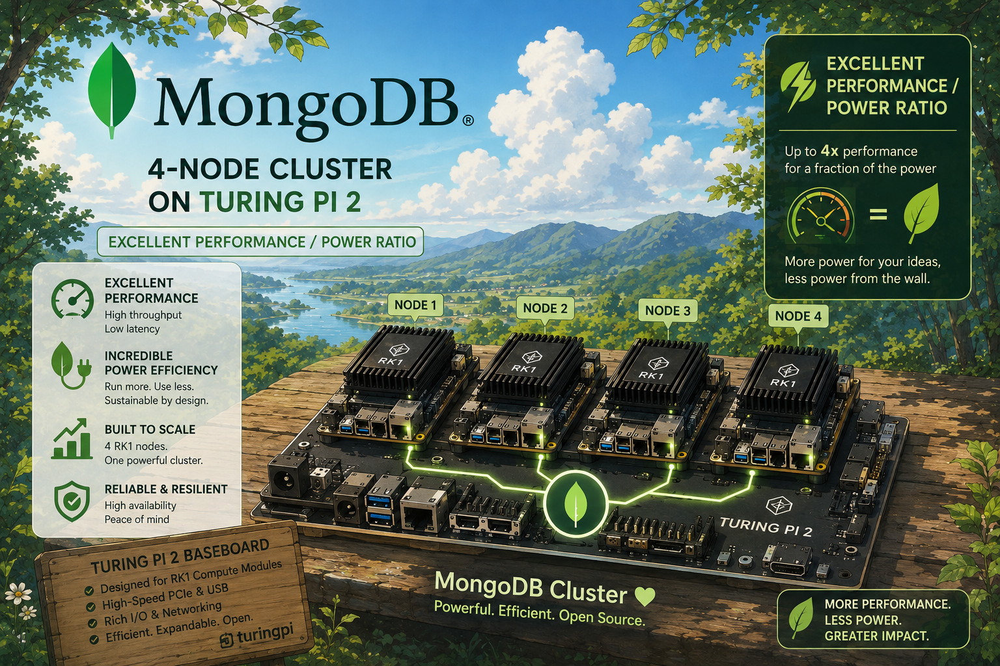
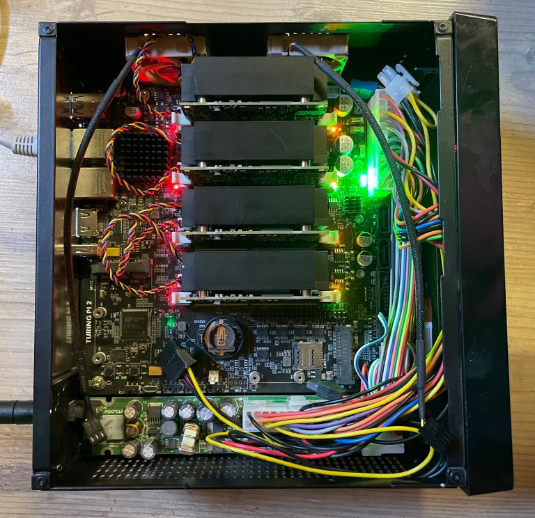
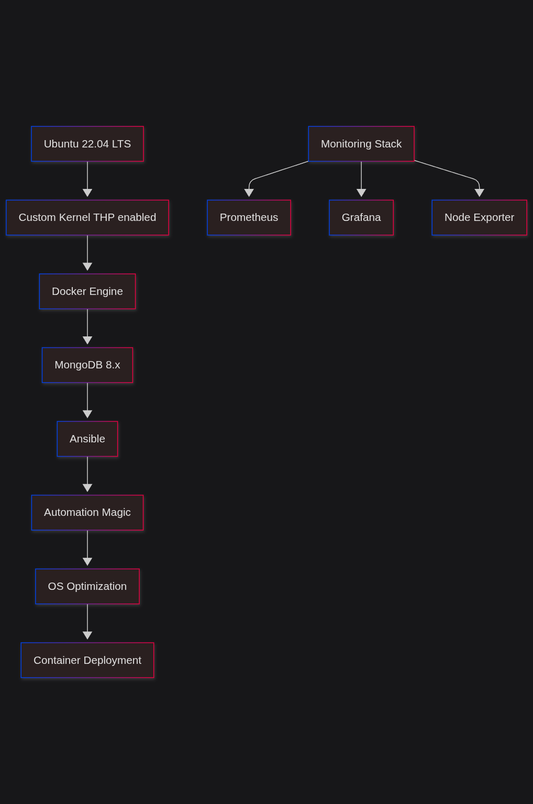
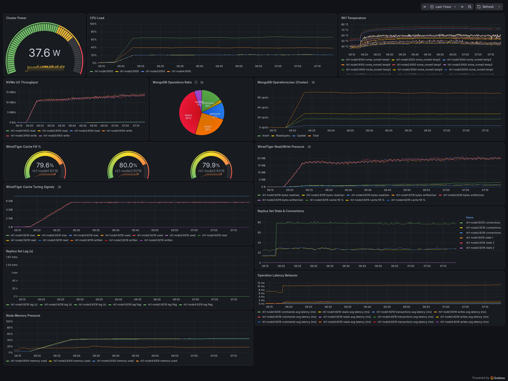
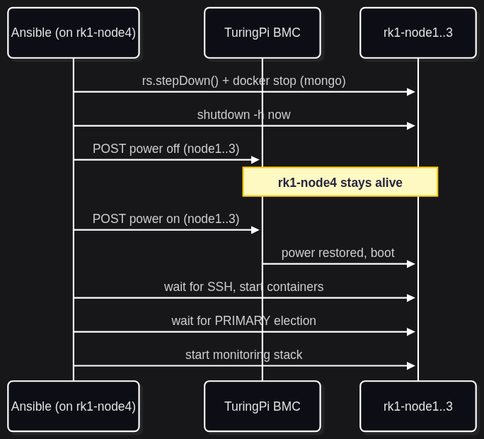

# 🚀 Building an amazingly small Beast: MongoDB on TuringPi ARM Cluster

[](LICENSE)


> *When you want to prove that ARM doesn't just mean your laptop battery lasts longer...*



## What's This All About? 🤔

Ever wondered what happens when you take four tiny ARM computers, stuff them into a mini-ITX sized board, and ask them to handle enterprise database workloads? Well, grab some coffee ☕ and step into the world of distributed ARM computing !

We're building a **MongoDB replica set** on the **TuringPi 2** platform using **RK1 compute modules** - basically creating a data center that fits in your backpack. 

## Meet the TuringPi 2: The ARM Avengers' Headquarters 🦾

The TuringPi 2 is like the Tony Stark of single-board computers - it takes regular compute modules and turns them into something extraordinary. Think of it as a **4-slot carrier board** that lets you cluster ARM-based compute modules together, including NVIDIA Jetson modules if you fancy.

The `img/` directory contains the hero artwork, the software-stack diagram, and
the captured benchmark chart used throughout this article.


### Why TuringPi is Cool:

- **Compact Design**: Mini-ITX form factor (same size as the smallest PC motherboard)
- **Modular Architecture**: Hot-swappable compute modules
- **Real Networking**: Gigabit Ethernet switching between nodes
- **Storage**: NVMe dedicated to each module
- **Enterprise Features**: BMC (Baseboard Management Controller) for remote management


## The Hardware Squad 💪

### Shopping list for our MongoDB Cluster:

| Component | Quantity | Specs | Role |
| --- | --- | --- | --- |
| **TuringPi 2** | 1x | Mini-ITX carrier board | The foundation 🏗️ |
| **RK1 Modules** | 4x | ARM64 RK3588, 16GB RAM | The workhorses 🐎 |
| **NVMe SSDs** | 4x | 400GB each | Speed demons ⚡ |
| **Heatsinks** | 4x | Active cooling | Chill vibes 🧊 |
| **24-pin PSU** | 1x | Standard ATX power | The juice ⚡ |

### RK1 Module Deep Dive 🔍

Each RK1 is basically a **smartphone SoC** on steroids. Here's what makes it tick:

- **CPU**: ARMv8-A RK3588 (4x Cortex-A76 + 4x Cortex-A55)
- **GPU**: Mali-G610 MP4 (yes, it can game!)
- **NPU**: Built-in AI acceleration providing 6TOPS (we will come to this in a next chapter...)
- **Memory**: 16GB LPDDR4 (exists in 8/16/32 flavor)
- **Storage**: 32G eMMC and NVMe support
- **Form Factor**: 260-pin SO-DIMM connector (Nvidia Jetson Compatible)
- **Networking**: 1x Gigabit Ethernet
- **Power**: ~9W per module including NVME (40W total cluster max!)

## The Software Stack: From Zero to Hero 🛠️

### Our Technology Choices:



### MongoDB Deployment Architecture:

```
┌─────────────┬─────────────┬─────────────┬─────────────┐
│  rk1-node1  │  rk1-node2  │  rk1-node3  │  rk1-node4  │
│   PRIMARY   │ SECONDARY   │ SECONDARY   │  CONTROL    │
├─────────────┼─────────────┼─────────────┼─────────────┤
│ MongoDB     │ MongoDB     │ MongoDB     │ Ansible     │
│ Data Node   │ Data Node   │ Data Node   │ Monitoring  │
│             │             │             │ Prometheus  │
│             │             │             │ Grafana     │
│             │             │             │ LoadTest    │
│             │             │             │             │
│ 16GB RAM    │ 16GB RAM    │ 16GB RAM    │ 16GB RAM    │
│ 256GB NVMe  │ 256GB NVMe  │ 256GB NVMe  │ 256GB NVMe  │
│ /data       │ /data       │ /data       │ /monitoring │
└─────────────┴─────────────┴─────────────┴─────────────┘
                            │
                   ┌────────┴────────┐
                   │   Replica Set   │
                   │  "turingpi_rs"  │
                   └─────────────────┘
```

### Connection Strings and Primary Failover

Applications should connect to all three data-bearing nodes and include the
replica set name. The MongoDB driver will discover the current primary and
automatically select a secondary after a primary failure and election:

```text
# Normal deployment with authentication enabled
mongodb://<user>:<password>@rk1-node1:27017,rk1-node2:27017,rk1-node3:27017/admin?authSource=admin&replicaSet=turingpi_rs

# Optional non-production/testing deployment after disable_mongodb_auth.yml
mongodb://rk1-node1:27017,rk1-node2:27017,rk1-node3:27017/test?replicaSet=turingpi_rs
```

Do not use `directConnection=true` or list only the current primary when you
need automatic failover. `rk1-node4` is the Ansible control and monitoring
host, not a MongoDB replica-set member, so it should not be included as an
application connection target. Replace the hostnames with the nodes' reachable
IP addresses or DNS names when connecting from outside the cluster network.

## Performance: David vs Goliath 📊

### Benchmark Results (PLGM & YCSB):

#### 🔥 The ARM Crusher (50% Write Workload)

- **Throughput**:  ops/sec
- **Latency (95th percentile)**: &lt;XYZ ms
- **Power Consumption**: 48W total cluster
- **Performance/Watt**:   ops/sec/watt

#### 🏃‍♂️ ARM Endurance Test (20% Write Workload)

- **Throughput**:  6300 ops/sec
- **Latency (95th percentile)**: &lt;XYZ 20ms
- **Power Consumption**: 36W total cluster
- **Performance/Watt**:   ops/sec/watt


### Compared to Traditional x86:

| Metric | TuringPi ARM | x86 Equivalent | ARM Advantage |
| --- | --- | --- | --- |
| **Power** | 40W | 1200W+ | 📉 95% less |
| **Cost** | $1200 | $2500 | 💰 50% savings |
| **Footprint** | Mini-ITX | 4x servers | 🏠 80% smaller |
| **Cooling** | On-demand fans| Always On fans | 🔇 Silent |


## The Installation Journey 🗺️

### Phase 1: Hardware Assembly (The Fun Part!)

```bash
# Step 1: Insert RK1 modules into TuringPi 2
# Step 2: Attach heatsinks (ARM modules run cool, but better safe!)
# Step 3: Install NVMe drives
# Step 4: Connect power and networking
# Step 5: Power on and watch the ARM magic happen! ✨
```

### Phase 2: Software Deployment (The Ansible Way!)

```bash
# Clone our automation repository
git clone https://github.com/<your-org>/<your-repo>
cd <your-repo>

# Run on rk1-node4 (facility/control node): installs & validates Ansible, then sets up SSH keys
./setup_facility-node.sh

# Deploy MongoDB cluster
ansible-playbook --ask-vault-pass -i inventory.yml deploy_mongodb_cluster.yml

# Optional: remove MongoDB login/password requirements for convenience or tests
# Run this only on non-production clusters; it disables authentication entirely.
ansible-playbook --ask-vault-pass -i inventory.yml disable_mongodb_auth.yml -e disable_mongodb_auth=true

# Update all RK1 nodes (including rk1-node4), one node at a time
ansible-playbook --ask-vault-pass -i inventory.yml update_rk1cluster.yml -e reboot=true

# Set up monitoring
ansible-playbook --ask-vault-pass -i inventory.yml setup_monitoring.yml

# Run the first unauthenticated mixed YCSB test against the primary
ansible-playbook --ask-vault-pass -i inventory.yml ycsb_load_test.yml -e confirm_unauthenticated_ycsb=true

```

The three MongoDB nodes format and mount `/dev/nvme0n1` as `/data` for database
files. `rk1-node4` is not a MongoDB member: its `/dev/nvme0n1` is formatted and
mounted as `/monitoring` by `setup_monitoring.yml`. Prometheus time-series data
is stored at `/monitoring/prometheus/data`, Grafana state at
`/monitoring/grafana/data`, and the monitoring configuration and dashboard are
kept alongside them. The playbook uses XFS with `noatime,nodiratime,logbufs=8`
and persists the mount in `/etc/fstab` through Ansible's `mount` module.

Grafana loads the dedicated **TuringPi MongoDB Cluster** dashboard
automatically into the `TuringPi` folder. Its source is
`grafana/turingpi-mongodb-dashboard.json`; the playbook copies it to
`/monitoring/grafana/provisioning/dashboards/` and provisions the Prometheus
datasource at `http://prometheus:9090`. No manual dashboard import is needed.
Feel free to add or import any other dashboards from [Grafana](https://grafana.com/grafana/dashboards/?dataSource=nobl9agent%2Cprometheus%2Cvictorialogs-datasource)


### First YCSB Load Test

`ycsb_load_test.yml` runs the pinned ARM64 `redis/go-ycsb` image from
`rk1-node4` against the primary, `rk1-node1`, using an unauthenticated direct
connection. It first loads the YCSB dataset, then runs a common mixed profile:
The playbook bypasses the image's incompatible bundled init wrapper and invokes
the native ARM64 `/go-ycsb` binary directly.

- 50% reads
- 30% updates
- 20% scans/searches

The default test loads 100,000 records and runs 100,000 operations with four
threads. Adjust the workload without editing the playbook:

```bash
ansible-playbook --ask-vault-pass -i inventory.yml ycsb_load_test.yml \
  -e confirm_unauthenticated_ycsb=true \
  -e ycsb_record_count=1000000 \
  -e ycsb_operation_count=500000 \
  -e ycsb_threads=8
```

This test is intended only for isolated, non-production use. The confirmation
flag is required, and the direct connection keeps operations on the primary.

### Six-Hour YCSB Endurance Test

Run the separate endurance playbook after the unauthenticated cluster is ready:

```bash
ansible-playbook --ask-vault-pass -i inventory.yml ycsb_endurance_test.yml \
  -e confirm_unauthenticated_ycsb=true
```

It loads the dataset once, then runs the same 50% read, 30% update, and 20%
scan/search profile for six hours (`21600` seconds) against the primary.

### Percona Load Generator MongoDB

In addition to YCSB, some PLGM runs were also performed; some using the extreme mode.
Consistent results were observed, just like the YCSB test suite. The performance limitation is coming from the memory, limited to 16G on our RK1 modules. For higher performance for specific workload types, the 32G model would probably help.

```bash
ubuntu@rk1-node4:~/rk1-ansible/plgm-workloads$ ./percona-load-generator-mongodb-4.6.0/bin/plgm config.std-3hours-50workers.yaml 
  [INFO] Performance: Automatically disabled driver compression (compressors=none)
Enter MongoDB Username: 
Warning: Collections path 'resources/collections' not found. Using embedded default.json.
Warning: Queries path 'resources/queries' not found. Using embedded default.json.

  plgm dev
  --------------------------------------------------
  Target URI:     mongodb://rk1-node1:27017,rk1-node2:27017,rk1-node3:27017?compressors=none
  Namespaces:     airline.flights
  Workers:        50 active
  Duration:       3h
  Workload Mode:  Default (Only default.json)

  WORKLOAD DEFINITION
  --------------------------------------------------
  Distribution:  Select (79%)  Update (11%)
                 Insert (3%)   Delete (5%)
                 Agg    (0%)   Trans  (0%)

2026/08/28 06:18:07 [Lifecycle] Phase=initializing: preparing collections, indexes, sharding setup, and optional seed data
2026/08/28 06:18:07 [Lifecycle] Init Step 1/3: preparing collections
  [INFO] Skipping sharding for 'flights': Cluster is not sharded (Replica Set)
2026/08/28 06:18:07 [Lifecycle] Init Step 2/3: creating indexes (declared indexes=6)
  [INFO] Created 6 indexes on 'airline.flights'
2026/08/28 06:18:07 [Lifecycle] Init Step 3/3: optional seed (skip_seed=true, documents_count=100000)
2026/08/28 06:18:07 [Lifecycle] Initialization completed in 210ms
2026/08/28 06:18:07 [Lifecycle] Phase=running: execution timers now track query workload only
2026/08/28 06:18:07 Starting Standard Workload iteration 1 of 1

> Starting Workload...
 TIME    | TOTAL OPS |  SELECT |  INSERT |  UPSERT |  UPDATE |  DELETE |    AGG | TRANS
 -----------------------------------------------------------------------------------------
 00:01   |     4,462 |   2,568 |   1,390 |       0 |     336 |     168 |      0 |     0
 00:02   |     8,796 |   4,904 |   2,950 |       0 |     638 |     304 |      0 |     0
 00:03   |     7,559 |   4,095 |   2,610 |       0 |     604 |     250 |      0 |     0
 00:04   |     6,973 |   3,680 |   2,570 |       0 |     480 |     243 |      0 |     0
 00:05   |     5,890 |   3,105 |   2,150 |       0 |     433 |     202 |      0 |     0
 00:06   |     5,384 |   3,026 |   1,760 |       0 |     414 |     184 |      0 |     0
 00:07   |     5,782 |   3,007 |   2,170 |       0 |     428 |     177 |      0 |     0
 00:08   |     5,310 |   2,911 |   1,810 |       0 |     418 |     171 |      0 |     0
 00:09   |     4,772 |   2,659 |   1,590 |       0 |     350 |     173 |      0 |     0
 00:10   |     5,613 |   3,117 |   1,920 |       0 |     400 |     176 |      0 |     0
 00:11   |     4,831 |   2,632 |   1,630 |       0 |     387 |     182 |      0 |     0

```
Result in grafana:


### Updating the RK1 Cluster

Use `update_rk1cluster.yml` to refresh the OS and container images on all cluster nodes, including the control node `rk1-node4`. The playbook runs one host at a time (`serial: 1`) to avoid rolling reboots or package conflicts during the upgrade window.

```bash
ansible-playbook --ask-vault-pass -i inventory.yml update_rk1cluster.yml
ansible-playbook --ask-vault-pass -i inventory.yml update_rk1cluster.yml -e reboot=true
```

What it does:
- updates the apt cache and performs a full `apt upgrade` on every managed RK1 node
- pulls all currently tagged Docker images from the local Docker daemon on each host
- checks whether a reboot is needed because of kernel or package updates
- reboots only when the `reboot=true` flag is set and `/var/run/reboot-required` exists

This is intended for regular maintenance windows and is especially useful after the cluster has been running for a while and Docker image versions need refreshing.

### Ansible Vault Variables

The playbooks load encrypted variables from `group_vars/all/vault.yml`. Create
or edit this file with Ansible Vault; do not store a plaintext copy in Git.
The file must define the following variables:

| Variable | Purpose |
| --- | --- |
| `vault_ansible_user` | SSH user used to connect to the RK1 nodes |
| `vault_ansible_ssh_private_key_file` | Path to the SSH private key used by Ansible |
| `vault_bmc_base_url` | TuringPi BMC HTTPS URL |
| `vault_bmc_user` | BMC login user |
| `vault_bmc_password` | BMC login password |
| `vault_bmc_validate_certs` | Whether Ansible validates the BMC TLS certificate |
| `vault_mongodb_admin_user` | MongoDB administrator username |
| `vault_mongodb_admin_password` | MongoDB administrator password |
| `vault_mongodb_admin_password_uri` | URL-encoded MongoDB password for connection URIs |
| `vault_mongodb_keyfile` | Replica-set internal authentication key |
| `vault_grafana_admin_password` | Grafana administrator password |
| `vault_mongodb_monitoring_uri` | Authenticated connection URI used by the MongoDB exporters on rk1-node1..3 |

Initialize the encrypted file, or update it after rotating credentials:

```bash
ansible-vault create group_vars/all/vault.yml
ansible-vault edit group_vars/all/vault.yml
ansible-vault view group_vars/all/vault.yml
```

Use the vault password when running any playbook that loads the inventory:

```bash
ansible-playbook --ask-vault-pass -i inventory.yml deploy_mongodb_cluster.yml
```

The vault password is separate from all service passwords. Store it in a
password manager or provide it through a protected `ANSIBLE_VAULT_PASSWORD_FILE`
that is excluded by `.gitignore`. Rotate any credentials that were previously
exposed before using this setup in production.


## ⏻ Stopping & Starting the Whole Platform

Two playbooks manage the full lifecycle of the cluster, useful for power savings overnight or just saving the planet:

```bash
# Graceful stop: step down primary → stop mongod containers → stop monitoring
# → shutdown rk1-node1..3's OS → cut power to rk1-node1..3 via the BMC
# (rk1-node4 is left running - it's the Ansible control node)
ansible-playbook --ask-vault-pass -i inventory.yml stop_platform.yml

# Power rk1-node1..3 back on via the BMC → wait for SSH → (re)start mongod containers
# → wait for a PRIMARY to be elected → start the monitoring stack
ansible-playbook --ask-vault-pass -i inventory.yml start_platform.yml
```

Power control goes through the TuringPi 2 BMC's REST API (`bmcd`), not the OS, so rk1-node1..3 are fully de-powered between runs. **rk1-node4 is intentionally excluded from both shutdown and BMC power-off** since it's the Ansible control and monitoring host running these very playbooks - the node itself always stays on. BMC connection settings and credentials are stored in Ansible Vault.



## Monitoring: Keeping an Eye on Our ARM Warriors 👁️

We've got a comprehensive monitoring setup running on `rk1-node4`:

### Metrics We Track:

- **System Metrics**: CPU, Memory, Disk I/O, Network
- **MongoDB Metrics**: Operations/sec, Connections, Replica Set Health, and WiredTiger cache usage
- **Power Consumption**: Via IoT smart plug integration with metrics fetched from HomeAssistant (full configuration not covered here)
- **Custom ARM Metrics**: Temperature, frequency scaling

### Dedicated Grafana Dashboard

The provisioned dashboard is designed for the three MongoDB data nodes and
uses a six-hour default time range with five-second refresh available. Panels
are grouped into three practical areas:

- **Hardware and host health**: cluster power, per-node CPU load, RK1
  temperature, NVMe read/write throughput, and node memory pressure.
- **MongoDB workload**: cluster-wide total operations/sec plus insert,
  read/query, and update rates.
- **MongoDB engine and cluster health**: WiredTiger cache used, configured
  cache size, cache utilization, current connections, and replica-set state.

The MongoDB exporter is Percona `0.40.0` with `--collect-all`. The dashboard
uses its emitted metric families, including `mongodb_ss_opcounters`,
`mongodb_ss_wt_cache_bytes_currently_in_the_cache`,
`mongodb_ss_wt_cache_maximum_bytes_configured`, and
`mongodb_ss_connections`. Replica state is read from the `rs_state` label:
`1` means PRIMARY and `2` means SECONDARY.

Grafana's image renderer is also enabled and available for the dashboard.
Use Grafana's panel or dashboard share controls to generate rendered PNG
images for reports, issue tickets, and quick status updates. The renderer is
deployed automatically as `grafana-image-renderer` by `setup_monitoring.yml`
and is secured with a shared authentication token between Grafana and the
renderer service.

To install or refresh the dashboard and monitoring stack:

```bash
ansible-playbook --ask-vault-pass -i inventory.yml setup_monitoring.yml
```

## Real-World Performance Stories 📈

### Story 1: The Endurance Test

We ran our cluster for **72 hours straight** with mixed workloads:

- **Zero downtime**: Replica set handled failovers gracefully
- **Consistent performance**: No degradation over time
- **Power consumption**: Averaged &lt;40 Watts 

### Story 2: The Scalability Surprise

- **Memory efficiency**: 16GB proved to be sufficient, but is workload dependent of course.
- **Storage performance**: NVMe drives delivered consistent latency

### Story 3: The Failover Test

Deliberately powered off `rk1-node1` (primary):

- **Failover time**: &lt;5 seconds
- **Data consistency**: Zero data loss
- **Recovery**: Automatic rejoin/resync/take-over when node returned

## The Economics: ARM's Secret Weapon 💰

### 3-Year Total Cost of Ownership:

#### TuringPi ARM Cluster:

- **Hardware**: $1620
- **Power** (3 years @ $0.2/kWh): $210
- **Total**: $1,830

#### Equivalent x86 Setup:

- **Hardware**: $2500
- **Power** (3 years @ $0.2/kWh): $6300
- **Total**: $8800

**ARM Savings: 80% cost reduction** 🎉 Main driver is power on the long-run 

## Lessons Learned &amp; Pro Tips 🎓

### What Worked Amazingly:

1. **ARM Performance**: Way better than expected for database workloads
2. **Power Efficiency**: Game-changer for edge deployments
3. **Ansible Automation**: Made deployment reproducible, idempotent and fast
4. **Container Strategy**: Docker simplified MongoDB management - probably slightly better performance on bare metal.
5. **Monitoring Stack**: Node Exporter + Prometheus + Grafana provided excellent visibility, and easy connection to external datasource (HomeAssistant for power)
6. **Percona Load Generator for MongoDB (PLGM)** : Excellent load/stress test coming with a web UI, insights, and lots of stuff. Got easily recompiled for ARM from the go source from github.
7. **YCSB**: Old load testing application, quite complex to run on a recent ARM Linux distro. Using a container image simplified this considerably, while also making results less directly comparable to bare-metal runs.

### Gotchas We Hit:

1. **ARM Docker Images**: Make sure you pull `arm64` variants
2. **Memory Management**: Tune MongoDB for ARM's memory characteristics
3. **NVMe Formatting**: XFS with specific mount options crucial for performance

### Performance Optimizations That Mattered:

```bash
# Disable transparent huge pages (ARM specific, made persistent via a systemd unit)
echo never > /sys/kernel/mm/transparent_hugepage/enabled

# MongoDB nodes: /dev/nvme0n1 is mounted at /data by deploy_mongodb_cluster.yml
mount -o noatime,nodiratime /dev/nvme0n1 /data

# Monitoring node (rk1-node4): /dev/nvme0n1 is mounted at /monitoring by setup_monitoring.yml
mount -o noatime,nodiratime,logbufs=8 /dev/nvme0n1 /monitoring

# Tune network buffers for ARM
sysctl -w net.core.rmem_max=16777216
sysctl -w net.core.wmem_max=16777216
```

### Further Performance Optimizations Worth Testing

- Benchmark `mongodb_wiredtiger_cache_size_gb` at `4`, `6`, and `8` on the
  16 GB RK1 nodes. The system currently defaults to `6` to keep more RAM
  available for Linux page cache, Docker overhead, and monitoring while still
  preserving a useful WiredTiger working set.
- A/B test `mongodb_wiredtiger_collection_compressor` between `zstd` and
  `snappy`. The current `zstd` default is space-efficient, but `snappy` often
  improves CPU-bound write throughput on ARM.
- Consider pinning the `mongod` container to the RK3588 Cortex-A76 cores during
  write-heavy benchmarks. The big.LITTLE topology can otherwise mix
  latency-sensitive database threads with background tasks.
- Publish two benchmark profiles instead of one: the current
  `directConnection=true` primary-only path for peak throughput and a
  replica-set-aware URI with stronger write concern to show the durability cost
  of production-like settings.
- Pin the monitoring containers away from `:latest` before long benchmark
  campaigns so exporter behavior and Prometheus/Grafana feature changes do not
  skew repeatability.

## Use Cases: Where This Shines ⭐

### Perfect For:

- **Edge Computing**: Data centers in remote locations
- **Development Clusters**: Cost-effective MongoDB testing
- **IoT Data Collection**: High-efficiency data ingestion with robustness built-in
- **Educational Labs**: Teaching distributed systems
- **Proof of Concepts**: Demonstrating ARM viability

### Maybe Not For:

- **Heavy Analytics**: x86 still wins on pure CPU crunch
- **Legacy Apps**: Software that assumes x86 architecture
- **Maximum Throughput**: When you need absolute peak performance

## Future Roadmap 🛣️

### Phase 2 Enhancements:

- [ ] **Kubernetes Integration**: Container orchestration layer
- [ ] **Automatic Scaling**: Dynamic node addition/removal to play with NVIDIA modules if required
- [ ] **ML Workloads**: TensorFlow Lite on ARM using the NPU embedded in the ARM core.
- [ ] **Multi-Cluster**: Federation across TuringPi units
- [ ] **Advanced Monitoring**: AI-powered performance analysis

### Phase 3 (The Dream):

- [ ] **5G Integration**: Edge deployment with cellular connectivity
- [ ] **Solar Power**: Complete off-grid operation
- [ ] **Satellite Connectivity**: MongoDB in space! 🚀

## The Verdict: ARM Has Arrived! 🏆

After some days of testing, playing, optimizing, discussing, and pushing this cluster to its limits (including a few crashes with the PLGM raw injector), here's our honest assessment:

### The Good 👍:

- **Performance**: Exceeded expectations for regular database workloads
- **Efficiency**: Power consumption is revolutionary. Less than a traditional light bulb while still delivering a real replica set.
- **Reliability**: Solid uptime and failover capabilities
- **Cost**: Dramatically lower TCO than x86
- **Fun Factor**: Building this was genuinely enjoyable!

### The Reality Check 🤔:

- **Software Ecosystem**: Still catching up to x86
- **Single-Thread Performance**: x86 wins on legacy workloads
- **Memory Bandwidth**: Some workloads need more than ARM provides

### Overall Rating: 8.5/10 ⭐

**TL;DR**: ARM-based database clusters are ready for prime time. The TuringPi + MongoDB combo delivers impressive performance per watt, costs significantly less than x86 alternatives.

## Getting Started: Your Turn! 🚀

Want to build your own TuringPi MongoDB cluster? Here's everything you need:

### Shopping List 🛒:
Prices 
```markdown
- 1x TuringPi 2 board ($280 )
- 4x RK1 16GB modules (~$300 each)
- 4x 400GB NVMe SSDs (~$30 each) 
- 4x Heatsinks (~$10 each)
- 1x ATX PSU (~$50)
- Networking cables and case (~$50)

Total: ~1620$ (was half in 2023, but prices are rising due to global chip shortage)
```

### Quick Start Commands:

```bash
# Clone our repository
git clone https://github.com/<your-org>/<your-repo>

# Run the setup on rk1-node4 (the facility node with Ansible and management tools)
cd <your-repo>
cat README.md

# Deploy in under 30 minutes
sh setup_facility-node.sh
ansible-playbook --ask-vault-pass -i inventory.yml deploy_mongodb_cluster.yml
ansible-playbook --ask-vault-pass -i inventory.yml setup_monitoring.yml

# Optional, non-production only: allow unauthenticated MongoDB access for tests
ansible-playbook --ask-vault-pass -i inventory.yml disable_mongodb_auth.yml -e disable_mongodb_auth=true

# Power the whole rig down/up (mongod + monitoring + BMC power) when not in use
ansible-playbook --ask-vault-pass -i inventory.yml stop_platform.yml
ansible-playbook --ask-vault-pass -i inventory.yml start_platform.yml
```

## Join the ARM Revolution! 🤝

This project is **open source** and we'd love your contributions:

- 🐛 **Bug Reports**: Found an issue? Let us know!
- 💡 **Feature Ideas**: What should we build next?
- 📚 **Documentation**: Help others learn from your experience
- 🧪 **Testing**: Try it on different ARM platforms. Run a specific workload ? Contact me.

### Connect With Us:

Replace the placeholders below with your final repository and social URLs before
publishing screenshots or sharing the article externally.

- **GitHub**: [turingpi-mongodb-cluster](https://github.com/<your-org>/<your-repo>)
- **LinkedIn**: Share your results with #TuringPi #MongoDB #ARM
- **Twitter**: Tweet your cluster pics with @turingpi
- **Discord**: Join the TuringPi community server

---

## Final Thoughts 💭

The future of computing is **distributed**, **efficient**, and **ARM-powered**. What we've built here isn't just a MongoDB cluster - it's a statement that the traditional boundaries of what's possible with ARM architecture are rapidly disappearing.

From **edge computing** to **data centers**, from **IoT gateways** to **development clusters**, ARM is proving that **performance per watt** is the metric that matters most in our increasingly connected world.

So grab a TuringPi, fire up some RK1 modules, and join us in building the future - one ARM cluster at a time! 🚀

---

*Built by ARM enthusiasts who believe that the best database clusters come in small, power-efficient packages.*

**P.S.** - If you build this setup, we'd love to see photos! Tag us on social media and show off your ARM-powered MongoDB cluster. The geekier the better! 🤓